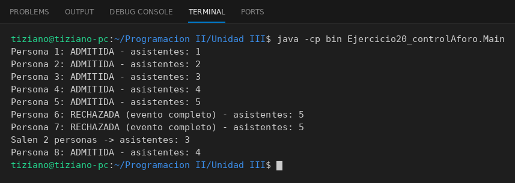

# ControlAforo

Programación II - Unidad 3 - Ejercicio 20

## Consigna
Modelar la clase aplicando encapsulamiento: atributos privados y métodos públicos que validan antes de modificar el estado. Un control de aforo con contador interno protegido.

## Lógica
- `registrarIngreso()` devuelve `false` si el evento está completo.
- `registrarSalida()` decrementa sin bajar de 0.
- Contador y capacidad privados.
- `Main` simula un ingreso masivo que supera el límite.

## Ejecución

